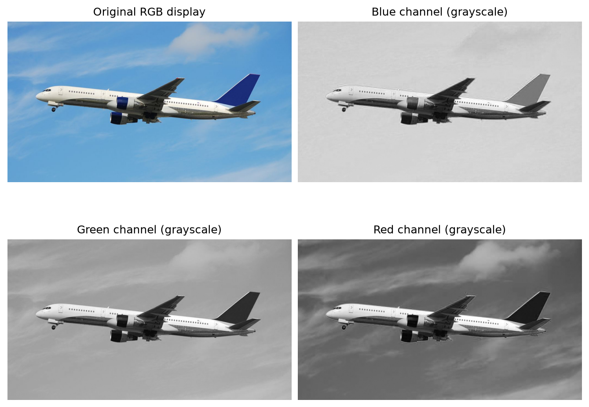
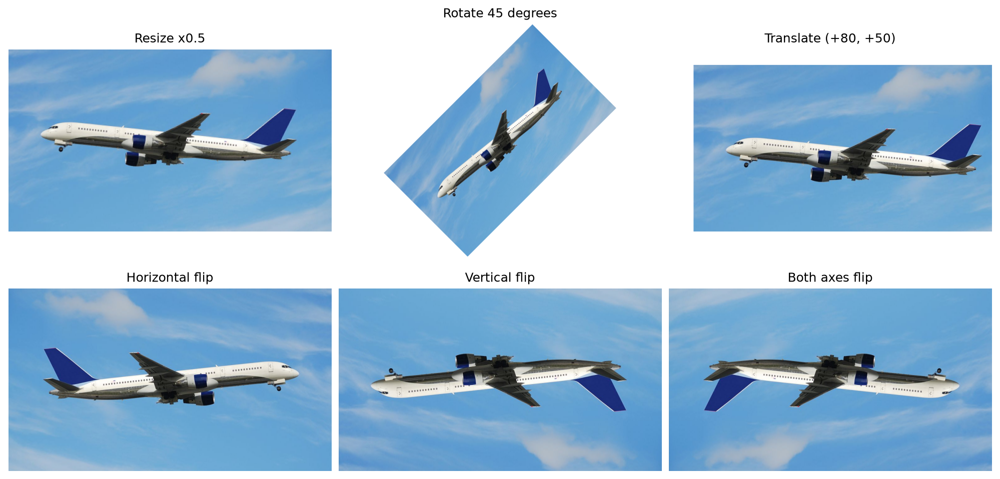
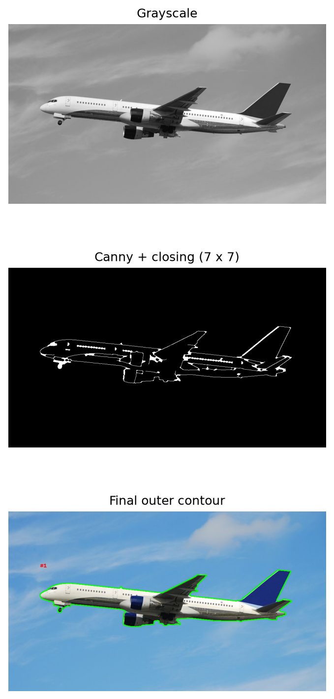
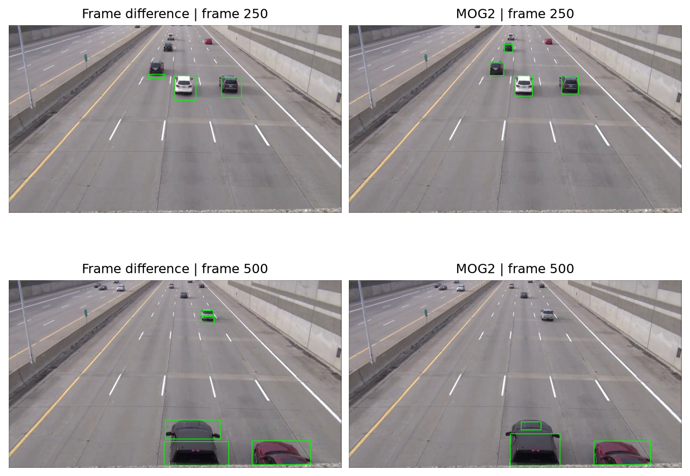
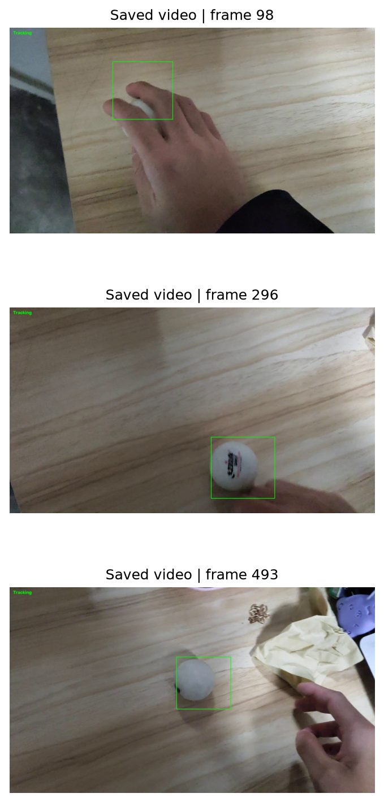

# Task2_OpenCV与Pillow实验报告

通道分离、几何变换、轮廓分析、运动检测与 CSRT 小球追踪

## 1  图像读取与颜色通道

example1.jpg 尺寸为 1036×584，三通道。OpenCV 默认以 BGR 顺序读取；转换为 RGB 后再交给 Pillow 显示和保存，避免红蓝通道互换。cv2.split 将三通道拆开，每个输出都是单通道强度图，不是把画面染成对应颜色。

源码：01_read_image.py；结果：channel_blue.png、channel_green.png、channel_red.png。读取后先检查是否为 None，避免路径错误继续传递到后续处理。

---

## 2  缩放、旋转、平移与翻转

| 操作 | 实现与参数 |
| --- | --- |
| 缩放 | 宽高各减半；INTER_AREA；1036×584 → 518×292 |
| 旋转 | 中心旋转 45°；扩大画布以容纳原图边角；双线性插值 |
| 平移 | x 方向 +80 像素、y 方向 +50 像素；保持原画布 |
| 翻转 | flipCode=1 水平；0 垂直；-1 双向 |

仿射变换以 2×3 矩阵同时表达线性变换与位移。旋转后画布尺寸由原宽高与 sin/cos 的绝对值计算，再调整平移项将原图中心移至新画布中心。缩放和旋转涉及插值，输出像素不一定对应某个原像素的直接拷贝。

---

## 3  轮廓提取与测量

流程：灰度化 → 5×5 高斯模糊 → Canny(80,160) → 7×7 椭圆核闭运算 → RETR_EXTERNAL 查找外轮廓。闭运算先膨胀再腐蚀，可连接部分小缺口，使机身、起落架等相近边缘形成连通区域。

| 复核项目 | 结果 |
| --- | --- |
| 外轮廓数量 | 1 |
| 轮廓总面积 | 72200.00 像素平方 |
| 轮廓总周长 | 2386.53 像素 |

面积由 contourArea 计算轮廓多边形面积，周长由 arcLength(contour,True) 计算闭合折线长度；它们不是航空器真实物理面积或长度。当前 02_contours.py 含先后两段处理代码，最终保存文件来自后一段 7×7 核处理。报告对该最终参数独立复算，而不沿用早期两个轮廓的统计。

---

## 4  相邻帧差与 MOG2 运动检测

帧差法先灰度化并高斯模糊相邻两帧，计算绝对差；阈值 25 转为二值掩码，5×5 开运算去噪、11×11 闭运算连接碎片。筛去面积小于 500 像素平方的轮廓后画外接框。它定位亮度发生变化的区域，因此慢速目标或车身内部可能响应不足，同一目标也可能出现多个框。

MOG2 为各像素维护随时间更新的背景混合模型。当前 history=300、varThreshold=16、detectShadows=True；对输出阈值化至 200 以上，只保留前景，随后使用相同形态学与面积筛选。其掩码中的阴影默认值为 127，故被排除。

当前抽帧表明两种方法能框出部分运动汽车，但仍有远处漏检、一个目标多框和边缘碎片。MOG2 需要背景适应过程，对静止或缓慢变化目标也有局限。没有逐帧真值框，报告只作定性比较，不报告虚构的 Precision/Recall。

[OpenCV：MOG2 参数与阴影掩码说明](https://docs.opencv.org/4.13.0/javadoc/org/opencv/video/BackgroundSubtractorMOG2.html)

---

## 5  小球 CSRT 追踪结果

05_ball_tracking.py 先播放视频，待小球可见时按 S 暂停，通过 selectROI 框选目标；在未画框的原始帧初始化 CSRT，再逐帧 update 得到框。CSRT 利用相关滤波并考虑通道与空间可靠性；实际执行只跟踪手工指定的单个目标，不自动识别小球类别。

框选可以发生在第一帧之后，脚本会重新读取并补存选中帧之前的画面，避免输出只剩后半段。追踪器初始化使用原图，避免把绿色框学成目标。Tracking 表示 update 返回成功，不等于经过真值验证的精确追踪。

---

## 6  视频文件完整性与待补项

| 视频 | 尺寸 | FPS | 容器帧数 |
| --- | --- | --- | --- |
| example2.mp4 | 1280×720 | 29.97 | 984 |
| example3.mp4 | 1920×1080 | 60.05 | 658 |
| ball_tracking.mp4 | 1920×1080 | 60.05 | 658 |
| motion_frame_diff.mp4 | 1280×720 | 29.97 | 984 |
| motion_mog2.mp4 | 1280×720 | 29.97 | 824 |

按视频容器信息核对，帧差结果保存了全部 984 帧，小球结果保存了全部 658 帧；MOG2 结果当前只有 824 帧，比输入少 160 帧。脚本允许按 Q 提前结束，这是一种可能原因，但现有文件不能证实具体原因。两种运动方法的抽帧比较仅使用已保存的共同范围。

当前 assets 下没有 example4.mp4，也没有对应第二段小球追踪视频。本报告不将该项写为已完成；提交任务二全部材料前，需要补齐该素材、追踪结果，并将 MOG2 视频处理到完整结束。报告本次只核实与记录现状，不代替缺失视频。

## 7  改进思路与复现

运动检测可使用道路 ROI、自适应面积阈值和相邻框合并，减少无关区域与远近尺度差异影响；需使用标注帧验证，避免增加闭运算核后把多辆车合并。小球追踪可缩紧初始框、避开手部、提高输入清晰度，并在遮挡后重新检测或重初始化；需要逐帧真值计算 IoU、中心误差和成功率。

依次运行 01_read_image.py、02_contours.py、03_motion_detection.py、04_motion_mog2.py、05_ball_tracking.py。小球脚本需要人工框选，不能在无人交互环境里假定已初始化成功。视频使用 mp4v 编码，写入器正常释放后再打开；播放器是否支持该编码，与是否补存前段画面是两个问题。

[OpenCV：CSRT 追踪器接口](https://docs.opencv.org/4.x/d2/da2/classcv_1_1TrackerCSRT.html)
