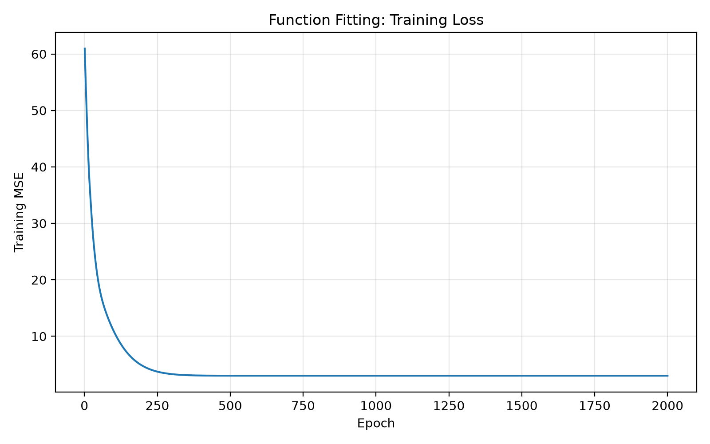
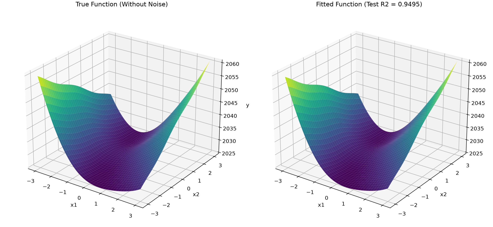
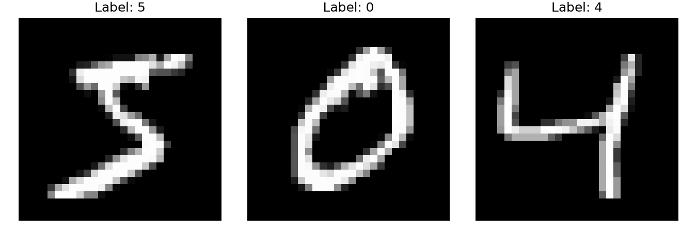
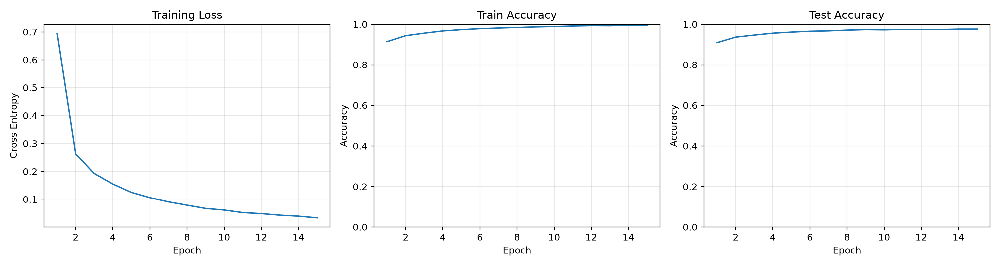
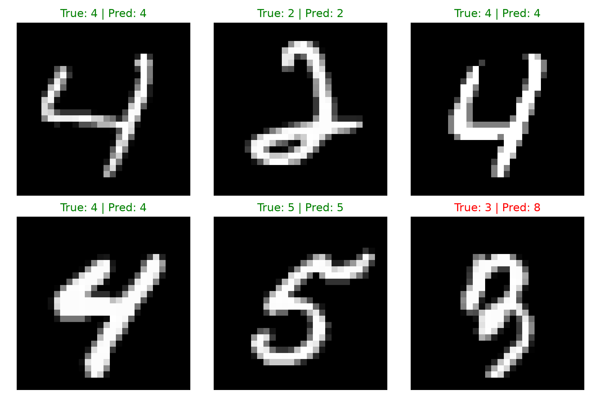
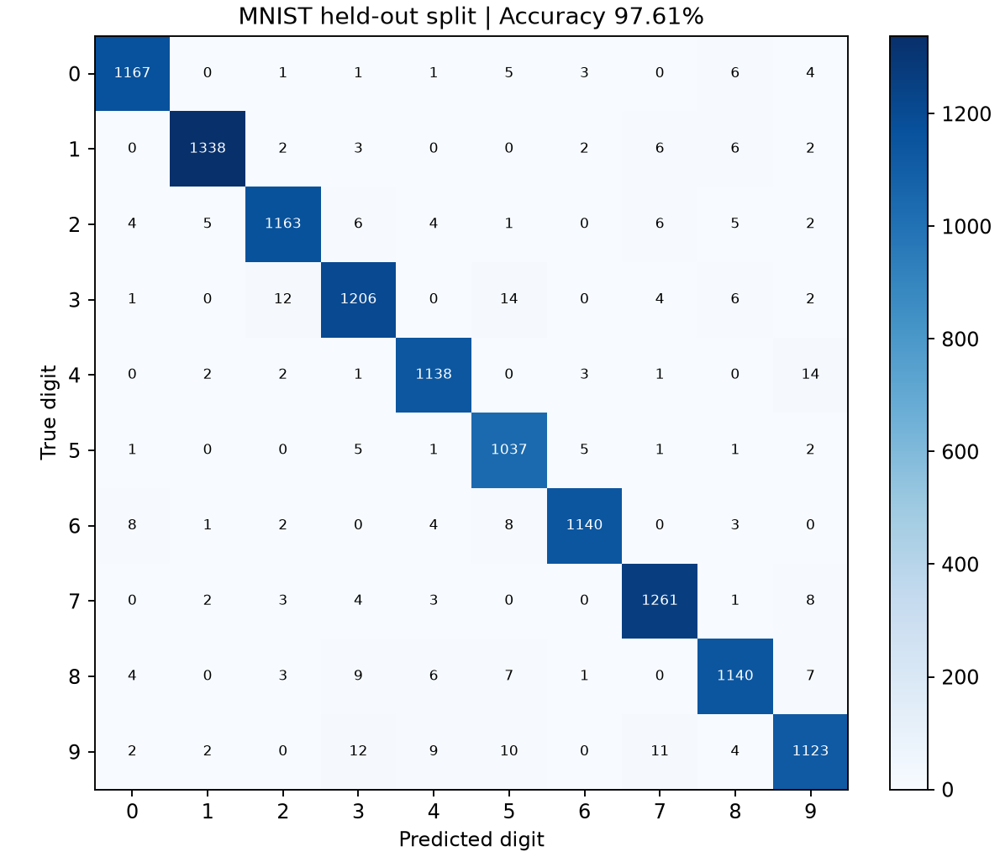

# Task3_PyTorch函数拟合与MNIST报告

自动求导、带噪二元函数拟合与多层感知机手写数字分类

## 1  神经网络基础概念

神经元先计算输入的加权和加偏置，再通过激活函数。权重描述各输入对输出的影响，偏置调整整体位置；层与层串联形成前向传播。隐藏层通过非线性变换学习中间表示，最后的输出层根据任务给出回归值或分类 logits。若所有层都是线性的，多层线性组合仍等价于一个线性变换。

| 概念 | 本实验中的含义 |
| --- | --- |
| Tensor | 带形状、数据类型与设备信息的多维数组；输入与参数放在相同设备 |
| Autograd | 记录可微运算关系，loss.backward() 按链式法则求参数梯度 |
| 梯度下降 | 根据损失对参数的梯度调整参数；优化器实现更新规则 |
| 损失 | 回归使用 MSE；分类使用交叉熵，衡量预测与标签的偏差 |
| 学习率 | 控制参数更新幅度，过大可能不稳定，过小可能收敛较慢 |
| Epoch / Batch / Iteration | 完整遍历训练集 / 一批样本 / 一次批次参数更新 |

一次训练步为清空旧梯度 → 前向预测 → 计算损失 → 反向求导 → optimizer.step。PyTorch 默认累积梯度，因此本实验每步显式 zero_grad。评估使用 model.eval() 与 no_grad/inference_mode；eval 切换 Dropout 等模块行为，无梯度上下文减少求导开销，两者作用不同。

## 2  泛化与正则化

训练表现差通常提示欠拟合或优化不足；训练表现很好而留出集明显下降则提示过拟合。划分训练、验证、测试后，训练集更新参数，验证集选模型与超参数，测试集评价锁定方案。Dropout 随机屏蔽训练特征；L1/L2 惩罚参数大小；BatchNorm 归一化中间特征分布。MNIST 实际使用 Dropout，没有使用 BatchNorm 或额外 L1/L2。

CPU 适合控制流程与小任务，GPU 适合批量并行张量计算；使用 GPU 不保证每种小模型都更快。float32、int64 等 dtype 与实际任务有关：输入是浮点，交叉熵的类别标签是 long 整数。

---

## 3  带噪二元函数与采样方案

真实函数：y=2x1²+1.5x1x2+3sin(x1)+0.5cos(2x2)+exp(-0.5x1)+0.8x2+2026。两个输入独立均匀采样于 [-3,3)，生成 2000 组，叠加 [-3,3) 的均匀随机噪声。种子为 42；以独立种子 123 打乱，1600 组训练、400 组测试。

模型保留已知函数形式，学习 a1、a2、a3、a4、a5、a6、b 七个参数；指数项为 exp(a5·x1)。这是参数化函数拟合，不是自由结构的多层神经网络。偏置用训练观测均值初始化，没有用测试标签初始化参数。

| 设置 | 数值 |
| --- | --- |
| 优化器 | Adam；学习率 0.03 |
| 训练方式 | 整批训练；2000 次参数更新 |
| 损失 | MSE = mean((预测 - 观测值)²) |
| 测试目标 | 含噪声的观测值；不参与训练 |

均匀噪声 [-3,3) 的方差为 (3-(-3))²/12=3。即使恢复真实函数，对独立含噪标签仍通常存在接近该量级的不可约平方误差，不能以损失非零判断拟合失败。

---

## 4  拟合参数与测试表现

| 参数 | 真实值 | 学习结果 | 绝对误差 |
| --- | --- | --- | --- |
| a1 | 2.0000 | 2.010338 | 0.010338 |
| a2 | 1.5000 | 1.476441 | 0.023559 |
| a3 | 3.0000 | 3.026465 | 0.026465 |
| a4 | 0.5000 | 0.504745 | 0.004745 |
| a5 | -0.5000 | -0.490974 | 0.009026 |
| a6 | 0.8000 | 0.813694 | 0.013694 |
| b | 2026.0000 | 2026.006470 | 0.006470 |

保存的测试 MSE=2.877410，R²=0.949507。R²=1-残差平方和/相对测试标签均值的总平方和，越接近 1 说明相对该常数预测的误差越小；R² 不表示某一比例样本完全预测正确。

参数与曲面整体吻合。参数不必精确等于真实值：训练包含噪声且样本有限，目标是降低观测误差。以上拟合数值取自 fit_results.txt，当前报告没有重新训练，也未把三维曲面上的无噪声误差混为测试 MSE。

---

## 5  MNIST 数据与 MLP 结构

从 train-00000-of-00001.parquet 读取 60,000 张 28×28 灰度手写数字。pandas 读取表格后，将 image.bytes 解码成灰度图，像素除以 255 并展平为 784 维；标签为 0~9 的整数。固定种子 42，按 80%/20% 划分为 48,000 训练、12,000 留出测试。

这里的测试集来自这份 60,000 样本文件的随机划分，不是 MNIST 官方另行提供的 10,000 张测试集，因此不能将本成绩直接当作官方标准测试协议结果。

| 阶段 | 形状 / 模块 |
| --- | --- |
| 输入 | batch×784；例如 512×784 |
| 隐藏层 1 | Linear(784,256) → ReLU → Dropout(0.2) |
| 隐藏层 2 | Linear(256,128) → ReLU |
| 输出层 | Linear(128,10)；输出 logits，不预先 softmax |
| 参数量 | 235,146 |
| 优化 | Adam；lr=0.001；交叉熵；batch=512；15 轮 |

交叉熵内部处理 logits 的归一化，预测取 argmax。Dropout 只在训练时生效，测试时关闭。此脚本保存最后一轮权重，没有独立验证集选最佳轮次，报告不能把最后一轮改写为验证集最优模型。

---

## 6  MNIST 训练曲线与预测示例

最后一轮：训练损失 0.0334，训练准确率 99.54%，测试准确率 97.61%。训练与测试相差 1.93 个百分点，说明仍存在泛化差距。

模型展平输入后不再显式保留二维局部邻域，笔画形态相似、连笔或书写差异会增加混淆风险。单张错例不能单独证明成因；需要结合全测试集统计判断。

---

## 7  保存权重的独立复核

本次重新载入 mnist_mlp.pth，按原脚本相同种子重建留出索引与预处理，在 12,000 张图片上推理。正确 11,713 张，准确率 97.61%，与最后一轮历史一致。没有进行新的训练。

训练期间每轮查看测试准确率，因此这是一份留出集监测结果，不能声称完全盲测。进一步改进可从原训练部分再划分验证集，用验证集选择学习率、宽度与训练轮数；锁定后使用正式独立测试集。卷积模型也可以利用笔画的局部结构，但该项题目实际完成的是 MLP。

源码分别为 00_check_torch.py、01_function_fit.py、02_mnist.py；结果保存在 task3/outputs。运行训练脚本会再次训练并更新输出；仅查看本报告和已有图表不需要重训。
