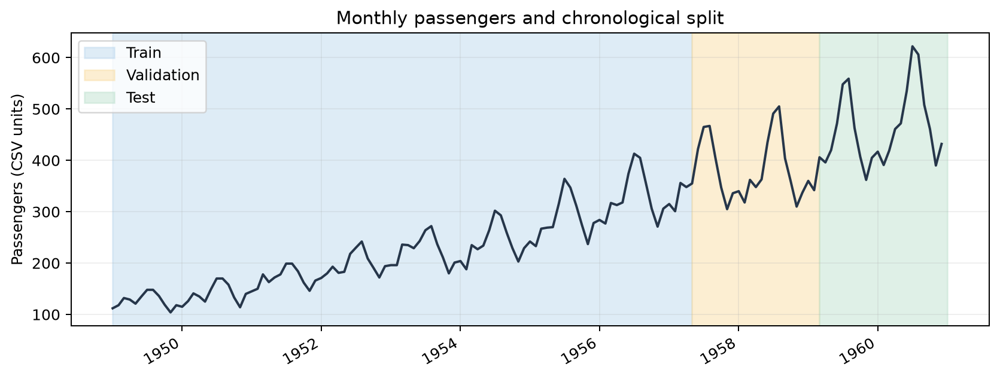
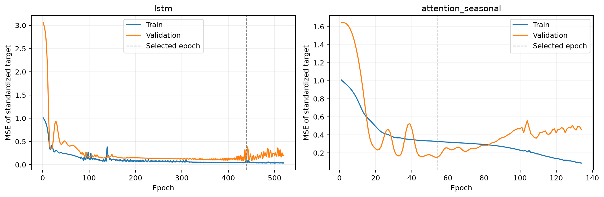
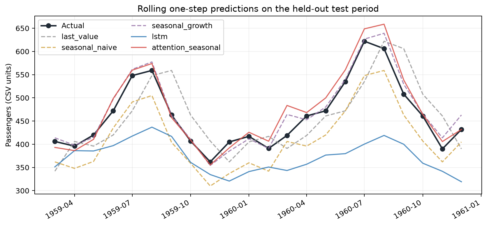
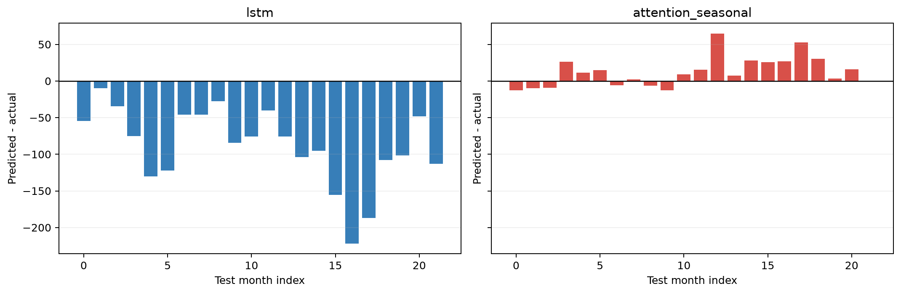
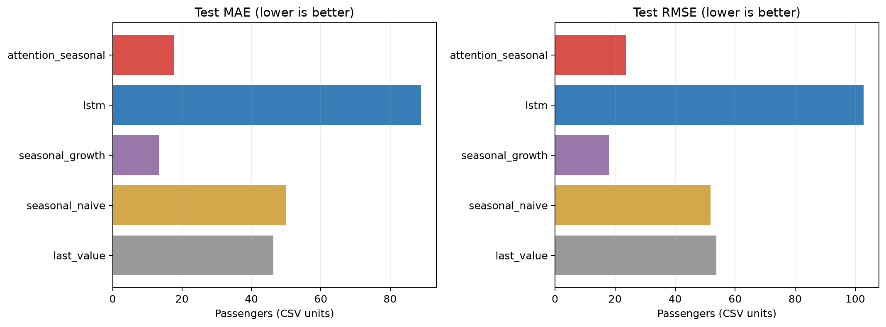
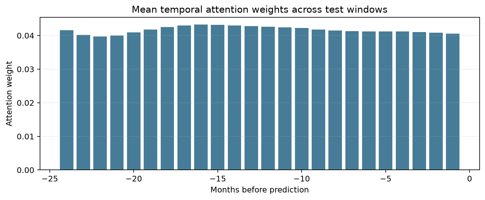
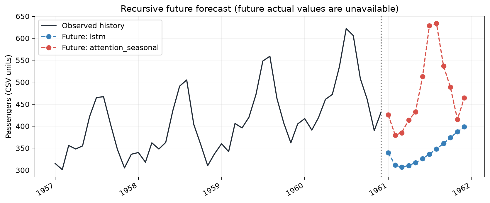

# Task4_时序预测实验报告

Air Passengers | 基础 LSTM、季节特征注意力模型与简单预测基线

## 1  数据与时间顺序划分

使用题目提供的 airline-passengers.csv，共 144 个月，1949-01 至 1960-12。数据为正的月度客流数值；本报告沿用 CSV 的数值单位，不作单位换算。序列同时存在长期增长与年度季节波动。读取时检查月份连续、无重复、数值有限且大于零。

| 集合 | 预测目标时间 | 窗口数 |
| --- | --- | --- |
| 训练 | 1951-01 至 1957-04 | 76 |
| 验证 | 1957-05 至 1959-02 | 22 |
| 测试 | 1959-03 至 1960-12 | 22 |

按原始时间点 70%/15%/15% 划分，输入窗口长度为 24 个月。前 24 个月只用于构造历史窗口，所以有效训练目标为 76 个月。输入与目标先取对数，再由训练时间段估计均值、标准差；验证和测试沿用训练统计量。

测试使用滚动单步协议：预测当月时允许使用此前已观测到的月份，包括较早的测试月份真实值，不使用当前月或未来值。这不等于在训练截止点一次性预测全部测试月份。

---

## 2  模型结构与训练方案

基础模型输入为标准化后的单变量对数客流序列，单层 LSTM(hidden=32) 编码 24 个月，取末时刻隐藏状态，经 Linear(32,16)、SiLU、Linear(16,1) 预测下一月对数值。LSTM 的门控结构控制历史信息保留和更新，用于表示时序依赖。

改进模型输入五维特征：对数客流、同比对数增长、月份 sin/cos 编码、同比信息可用标志。LSTM 输出全时间步状态，以 Linear(32,16)→Tanh→Linear(16,1) 打分，softmax 得到 24 个时间权重；加权上下文与末状态拼接后进入回归头。目标改为相对去年同月的对数残差，反归一化后加回去年同月对数基准，再 exp 恢复原单位。

| 配置 | 设置 |
| --- | --- |
| 优化 | AdamW；lr=0.004；weight_decay=0.0001 |
| 损失与稳定性 | 标准化目标 MSE；梯度裁剪 1.0；整批训练 |
| 停止与选择 | 最多 600 轮；80 轮未改善则早停；按验证损失保存 |
| 基础模型 | 5,025 参数；最佳 439 轮；运行 519 轮 |
| 改进模型 | 6,594 参数；最佳 54 轮；运行 134 轮 |

改进版同时改变特征、目标与注意力模块，属于组合实验，不能把所有效果单独归功于注意力。训练在 CPU 上完成，随机种子 42；测试只在选定权重后评价。

---

## 3  原单位测试指标与预测对照

| 模型 | MAE | RMSE | MAPE (%) | R² |
| --- | --- | --- | --- | --- |
| last_value | 46.364 | 53.725 | 10.085 | 0.4295 |
| seasonal_naive | 49.909 | 51.783 | 10.908 | 0.4700 |
| seasonal_growth | 13.350 | 17.920 | 2.904 | 0.9365 |
| lstm | 88.919 | 102.743 | 18.272 | -1.0864 |
| attention_seasonal | 17.769 | 23.657 | 3.751 | 0.8894 |

改进版相对基础 LSTM 的 RMSE 下降 76.97%。但本次最优为 seasonal_growth，RMSE=17.920，优于改进神经网络的 23.657。基础 LSTM 的 R² 为负，表示该测试段上平方误差大于用测试真值均值作常数预测的误差；失败结果保留用于分析。

MAE 是绝对误差均值；MSE 是平方误差均值；RMSE=sqrt(MSE)，与原数据同单位；MAPE 为绝对相对误差均值乘 100%。本数据真值均为正，避免零分母。报告生成时由逐月预测 CSV 重算 MAE 与 RMSE，并与指标表核对一致。

---

## 4  基线、误差与注意力分析

last_value 用上月真实值；seasonal_naive 用去年同月真实值；seasonal_growth 在去年同月值上乘以训练段估计的平均年度增长倍数。三种基线均只使用预测时刻之前的信息，增长率不使用验证或测试期拟合。

单样本网络前向耗时原记录：LSTM 0.118 ms，改进版 0.150 ms；预热 10 次后测试 100 次，不含读取、特征生成与写图。改进版更慢，不能宣称同时提高速度与精度。小模型和单次短测易受系统状态影响。

---

## 5  未来预测与使用边界

| 月份 | 基础 LSTM | 改进模型 |
| --- | --- | --- |
| 1961-01 | 339.39 | 425.76 |
| 1961-02 | 311.40 | 379.51 |
| 1961-03 | 307.05 | 384.80 |
| 1961-04 | 310.29 | 413.82 |

未来区间没有真实值可供当前验证，也未输出校准的预测区间。滚动单步测试使用已观测历史，而递归未来预测会积累预测误差，两者评价协议不同，不能将测试 RMSE 直接当成未来 12 个月误差。

本次单个小数据集、单个随机种子的实验仅说明当前方案表现。季节增长基线比神经网络更好，提示清晰的季节性与趋势结构可能比增加网络复杂度更关键。后续可以在验证段进行滚动时间验证和多种子实验，再确定是否值得采用复杂模型。

源码为 timeseries_forecasting.py，支持训练和加载保存权重预测；模型文件含网络配置及归一化参数。结果位于 outputs/final_run，逐月预测、训练历史、模型指标、未来预测及七张图均可复核。常用命令见 README_使用说明.md。
