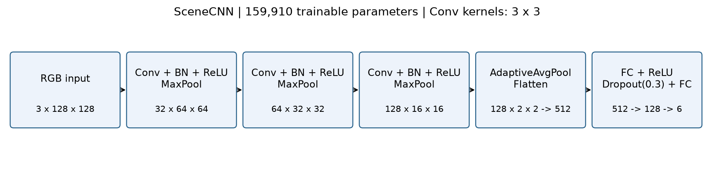
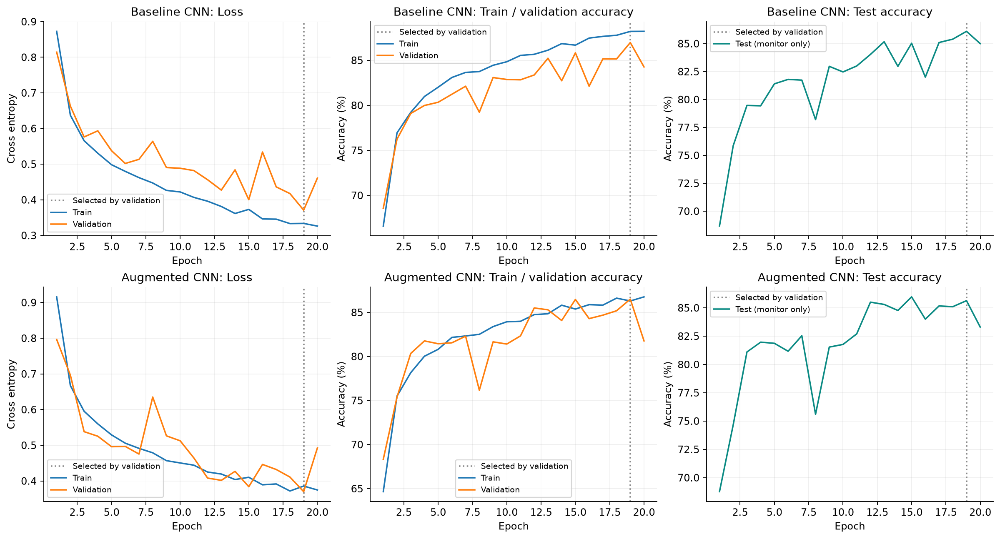
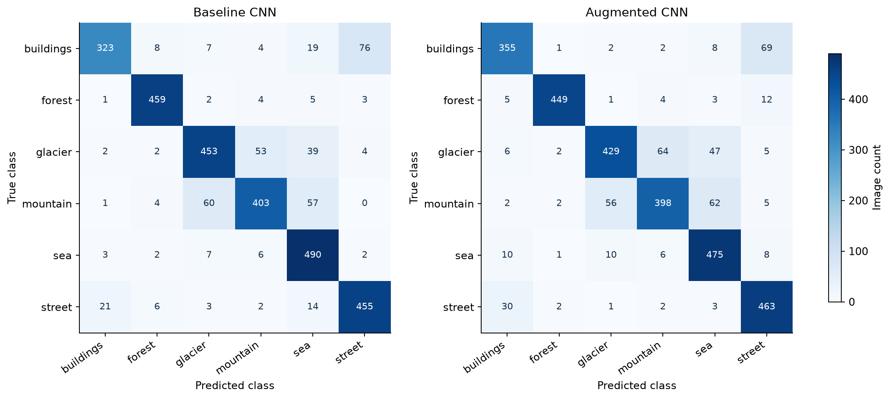
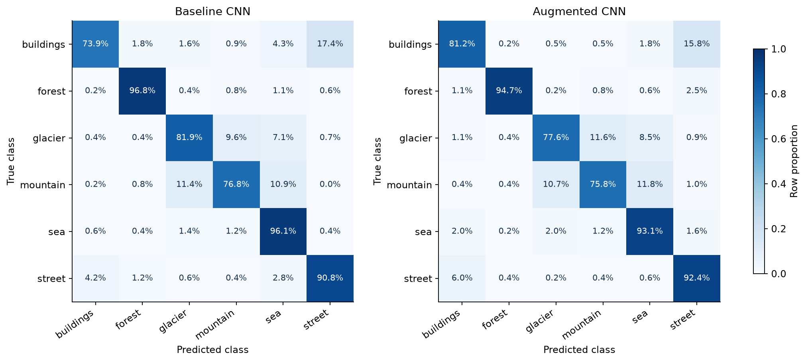
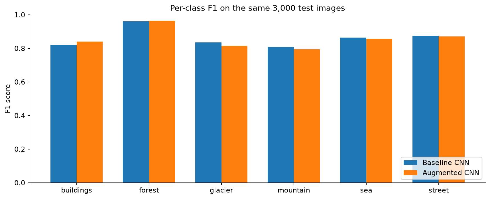
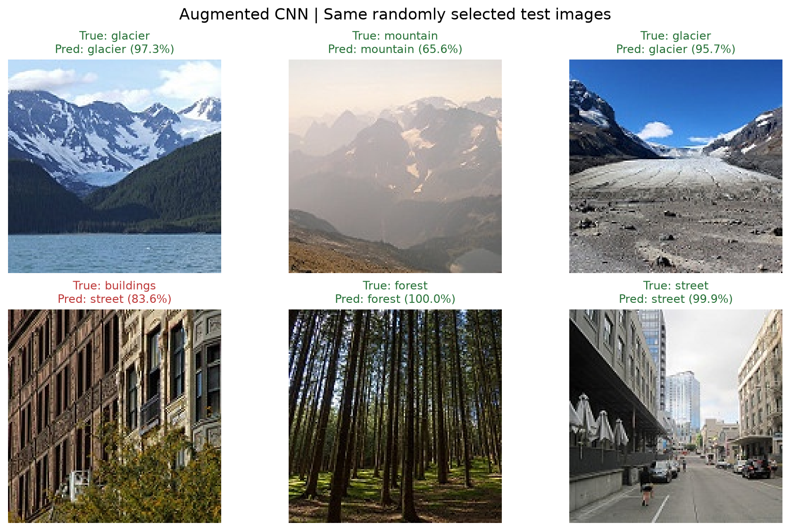
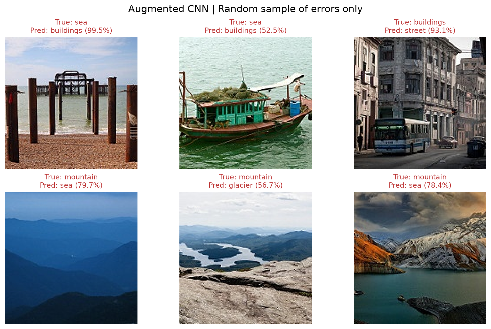

# 图像分类实验报告

## 1. 任务与数据

使用 Intel Image Classification 的六类场景图片：buildings, forest, glacier, mountain, sea, street。训练目录共 14034 张，固定随机种子 42 按 80%/20% 划分为 11227 张训练图与 2807 张验证图；独立测试目录共 3000 张。两种实验使用相同划分、网络和优化参数。

输入转换为 RGB，缩放至 128×128，像素先除以 255，再按均值 0.5、标准差 0.5 归一化，即 x'=2x-1。类别编号和各集合计数见 dataset_counts.csv。未进行跨目录重复图片审计，因此此处“独立”指目录与训练更新分离。

## 2. 模型结构与原理

三组 Conv2d(3×3, padding=1, bias=False)、BatchNorm2d、ReLU、MaxPool2d(2)，通道数为 3→32→64→128。空间尺寸依次为 128→64→32→16。卷积用共享权重提取局部边缘与纹理；批归一化调整中间特征分布；ReLU 引入非线性；池化降低空间尺寸与计算量。

随后 AdaptiveAvgPool2d((2,2)) 得到 128×2×2 特征，展平为 512 维，经 Linear(512,128)、ReLU、Dropout(0.3)、Linear(128,6) 输出六个 logits。总参数量 159,910。训练直接将 logits 传入交叉熵，预测取 argmax；图中的置信度来自 softmax，不能解释为已校准的正确概率。

## 3. 训练方案与增强实验

PyTorch 2.10.0+cu128，torchvision 0.25.0+cu128，设备 NVIDIA GeForce RTX 5070 Laptop GPU。AdamW 学习率 0.001、weight_decay=0.0001，交叉熵损失，batch_size=64，各训练 20 轮。损失按样本数加权汇总。仅以验证准确率最高保存 best.pth；本次复核未重新训练。

增强版仅改变训练变换：RandomResizedCrop(128, scale=(0.8,1.0), ratio=(0.9,1.1))、概率 0.5 的水平翻转、brightness/contrast/saturation 均为 0.15 的 ColorJitter。它们增加位置、尺度和光照变化；过强裁剪也可能损失场景线索。验证与测试始终使用确定性预处理。

Windows 采用同进程四线程、最多四批预读，避免多进程共享内存错误；GPU 模式限制 PyTorch CPU 线程为 1。随机增强由线程执行，固定种子不保证逐位复现。训练准确率是在训练模式、各批更新过程中统计，增强版还使用增强输入，不能与固定模型的验证准确率直接等同。

## 4. 训练曲线

曲线分别为训练/验证交叉熵、训练/验证准确率、每轮测试准确率。竖线标记验证集选择的轮次。测试集每轮只用于监测，不参与反向传播或最佳权重选择；由于训练期间查看过测试曲线，不能把它描述为完全盲测。最后一轮不一定等于最佳轮次。

## 5. 当前最佳权重的测试结果

| 模型 | 最佳轮次 | 验证准确率 | 测试准确率 | 正确/总数 | Macro F1 |
|---|---:|---:|---:|---:|---:|
| 基础 CNN | 19 | 86.96% | 86.10% | 2583/3000 | 0.8605 |
| 增强 CNN | 19 | 86.50% | 85.63% | 2569/3000 | 0.8574 |

测试准确率差（增强减基础）为 -0.47 个百分点。本次增强模型未超过基础模型，不能把数据增强写成已验证的性能提升。 两者只进行了当前这一组训练，未做多随机种子或显著性检验，不宣称统计优势。根据验证集选择，本次建议使用 **cnn_baseline**。

Accuracy=正确数/总数；每类 Precision=TP/(TP+FP)，Recall=TP/(TP+FN)，F1=2PR/(P+R)。Macro F1 对六类等权平均；weighted F1 按真实样本数加权。若分母为零，代码将相应值定义为零。详见 model_comparison.csv 与各模型 classification_report.csv。

矩阵行是真实类别，列是预测类别。计数版展示错误数量；归一化版每行合计 100%，对角线即该类召回率。

Baseline CNN 主要混淆：buildings→street：76 张；mountain→glacier：60 张；mountain→sea：57 张。这是根据预测统计得到的现象，单靠混淆矩阵不能确定成因。

Augmented CNN 主要混淆：buildings→street：69 张；glacier→mountain：64 张；mountain→sea：62 张。这是根据预测统计得到的现象，单靠混淆矩阵不能确定成因。

## 6. 分类结果与错误案例

固定随机种子 2026，从完整测试集随机选取六张，同一批图片分别展示两种模型结果；绿色标题为正确，红色为错误。另从增强版全部错误中固定随机抽取六张用于分析，不把错误案例当作随机整体表现。sample_indices.json 记录抽样索引，逐图 CSV 包含文件、标签及 softmax 置信度。

相近场景可能共享颜色和纹理，例如冰川与山地、街道与建筑。误判分析应结合具体图片，避免仅凭类别名称断言原因。后续可以只使用验证集比较更温和的裁剪、学习率调度、早停、轻量注意力模块，再对锁定配置进行最终测试。

## 7. ViT 原理理解

Vision Transformer 将图像切分为固定大小的 patch，每个 patch 展平后线性映射成 token，加入位置编码，再由 Transformer Encoder 的多头自注意力与前馈层处理。自注意力根据 Q、K、V 计算 token 间关联，形式为 softmax(QK^T/sqrt(d))V，使不同位置的信息相互交换。原始 ViT 使用可学习的分类 token 汇聚全局信息，再由分类头预测。

与卷积的局部感受野和权重共享相比，自注意力可以直接关联远距离 patch；常规全局注意力的计算/内存成本随 token 数近似二次增长。ViT 的效果依赖数据规模、训练和正则化方案，不能简单保证优于 CNN。本项目按题目要求理解原理，实际实现 CNN 与数据增强对照，没有训练或虚构 ViT 指标。

参考：[Dosovitskiy 等，An Image is Worth 16x16 Words](https://arxiv.org/abs/2010.11929)。数据集参考：[Intel Image Classification](https://www.kaggle.com/datasets/puneet6060/intel-image-classification)。

## 8. 使用与复核

在 VS Code 选择 comsen-answer 环境。已有权重时直接运行 05_finish_classification.py，可重新生成本报告的图表与指标；06_predict_image.py 可预测自己的图片。两者都不启动训练。README.md 给出命令与目录。

summary.json 保存环境、划分、完整混淆矩阵与当前权重/历史 SHA-256；本报告每次以实际载入的 best.pth 重新计算结果，不沿用过往训练的旧测试表。报告 PDF 是同次结果的排版导出；重新训练后需重跑整理脚本并重新导出 PDF。
